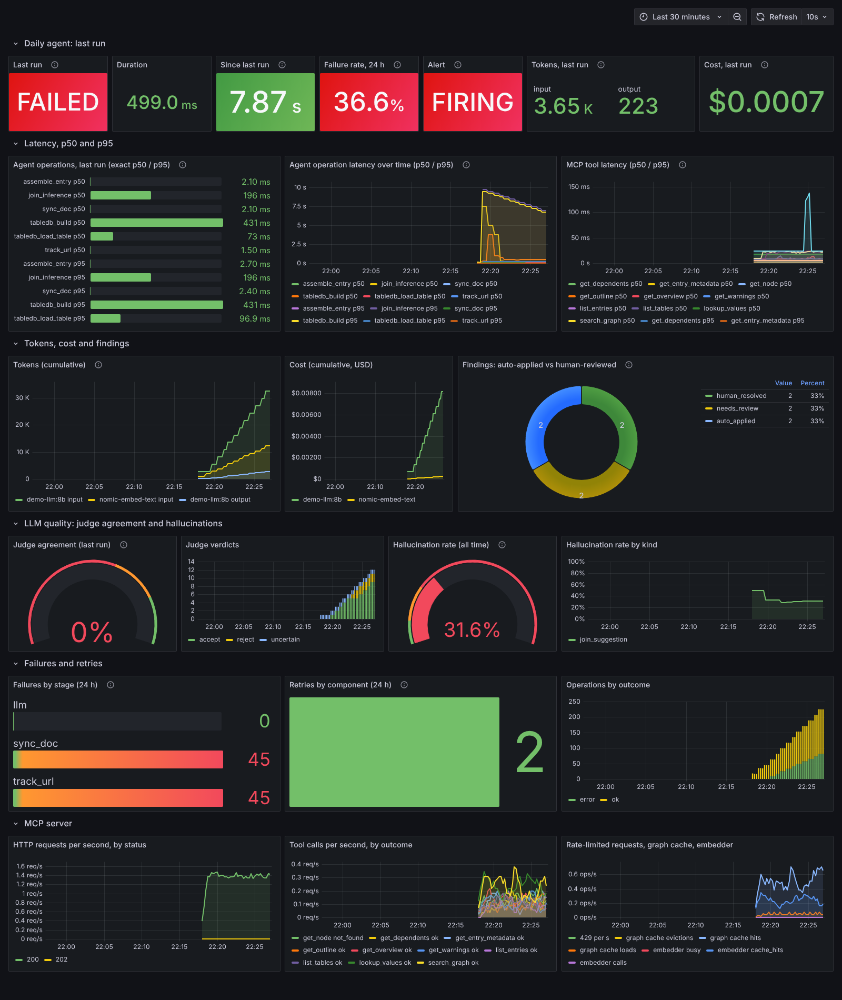

# Observability: traces, metrics, dashboard, alert

The daily agent and the MCP server emit **OpenTelemetry traces** and **Prometheus metrics**. A Grafana dashboard and one alert rule ship in `deploy/observability/`.



The screenshot was taken from a real Prometheus and Grafana, fed by `deploy/observability/demo/generate_traffic.py` (see "Reproduce the screenshot"). The traffic is synthetic: a mock web site, a mock Ollama that reports token counts and sometimes invents a column, and an illustrative price. It shows what the panels look like, not how your sources behave.

Code: `src/kg_telemetry.py` (registry, tracing helpers, per-run summary); calls are spread through `kg_agent.py`, `kg_mcp.py`, `kg_llm.py`, `kg_llmjoin.py`, `kg_embed.py`, `kg_tools.py`, `kg_tabledb.py`, `kg_ingest.py` and `kg_daemon.py`.

## 1. Tracing (OpenTelemetry)

Tracing is optional. Without the packages (or without an endpoint) every call is a no-op.

```bash
pip install opentelemetry-sdk opentelemetry-exporter-otlp-proto-http
python3 src/kg_agent.py --home kg_agent_home run --otlp-endpoint http://127.0.0.1:4318      # or OTEL_EXPORTER_OTLP_ENDPOINT
python3 src/kg_mcp.py   --home kg_agent_home serve --metrics --otlp-endpoint http://127.0.0.1:4318
docker compose -f deploy/observability/docker-compose.observability.yml --profile traces up -d   # Jaeger UI on http://127.0.0.1:16686
```
`--trace-console` prints finished spans to stderr instead (needs only the SDK). `OTEL_SERVICE_NAME` renames the service (`cogent-agent`, `cogent-mcp`).

| span | where | main attributes |
|---|---|---|
| `agent.run` | one per run, root | `cogent.run_id`, `cogent.forced`, `cogent.dry_run`, success and error counts |
| `agent.step <node>` | each LangGraph node of the workflow | `cogent.step`, outcome |
| `agent.op <name>` | `track_url`, `sync_doc`, `assemble_entry`, `tabledb_build`, `tabledb_load_table`, `join_inference` | `cogent.op`, entry/table/url, `outcome`, error text |
| `http.fetch` | every conditional download | URL (query string removed), whether it was conditional, status |
| `llm.chat`, `embed` | every Ollama chat / embedding call | `gen_ai.system`, `gen_ai.request.model`, `gen_ai.operation.name`, token counts, retries |
| `joins.evaluate` | LLM join suggestion + judge for one document | table count, hallucinated/judge counters |
| `mcp.tool <name>` | every MCP tool call | `mcp.tool.name`, `cogent.ref`, outcome; exceptions are recorded |
| `http <METHOD> <path>` | each HTTP request to the MCP server | `http.request.method`, status; parent taken from an incoming `traceparent` |
| `daemon.run` | the daemon's supervised run | `cogent.trigger`; the agent's `agent.run` is its child |

The daemon passes its trace to the agent it starts through the environment variable `COGENT_TRACEPARENT` (W3C `traceparent` format). The standard `TRACEPARENT` is deliberately not used, because a stray unsampled value in a shell would silence all spans. An incoming `traceparent` header on an MCP request becomes the parent of `mcp.http`.

## 2. Metrics

`src/kg_telemetry.py` holds a small registry (counters, gauges, histograms) written in the standard library; there is no `prometheus_client` dependency. Both kinds of process use it:

* **The agent is a batch job.** At the end of each run it merges its numbers into `<home>/metrics/agent.json` (cumulative counters, gauges for the last run) and writes `<home>/metrics/agent.prom` (Prometheus text format, for the node_exporter textfile collector). With `--pushgateway URL` it also pushes them.
* **The MCP server** (`serve --metrics`) exposes `/metrics` (a token is required). It prints its own live metrics and merges the agent's persisted totals, so **one scrape target shows everything**.

### What is recorded

| Question | Metrics |
|---|---|
| **Latency p50 / p95** | `cogent_agent_run_duration_seconds`, `cogent_agent_step_duration_seconds{step}`, `cogent_agent_operation_duration_seconds{op}`, `cogent_mcp_tool_duration_seconds{tool}`, `cogent_llm_call_duration_seconds` are histograms: use `histogram_quantile(0.95, sum by (le) (rate(..._bucket[1h])))`. `cogent_agent_operation_latency_seconds{op,quantile="0.5"|"0.95"}` is the **exact** p50/p95 of the last run, computed from the raw samples (a run has too few samples for histogram buckets to be accurate). |
| **Tokens and cost per run** | `cogent_llm_tokens_total{model,direction}`, `cogent_llm_cost_usd_total{model}`, `cogent_llm_calls_total{model,outcome}`; last run: `cogent_agent_last_run_tokens{direction}` and `cogent_agent_last_run_cost_usd`. Tokens are the `prompt_eval_count` and `eval_count` that Ollama returns. Cost = tokens x price from `COGENT_LLM_PRICES`. |
| **Auto-applied vs human-reviewed** | `cogent_agent_findings_total{outcome}` with `auto_applied` (the agent applied the change), `needs_review` (it left the finding for a person), `human_resolved` (a person resolved a finding that was waiting). |
| **Judge agreement** | `cogent_join_judge_agreement_ratio` (share of candidates on which all judge runs agreed; only counted when the judge ran at least twice), `cogent_join_judge_verdicts_total{verdict}`, `cogent_join_judge_candidates_total`, `cogent_join_judge_llm_vs_deterministic_total{result}` (does the judge confirm what the heuristics found). |
| **Hallucination rate** | `cogent_llm_outputs_total{kind,grounded}` and `cogent_llm_hallucination_ratio{kind}`. See the definition below. |
| **Failures and retries** | `cogent_agent_failures_total{stage}`, `cogent_agent_retries_total{component}`, `cogent_agent_operations_total{op,outcome}`, `cogent_agent_runs_total{outcome}`. Stages: fetch, llm, embed, tabledb, daemon_run ... |
| MCP server | `cogent_mcp_tool_calls_total{tool,outcome}`, HTTP request counters, rate-limited requests, graph-cache and embedder gauges |

### Definitions you should know before trusting a number

* **Hallucination** is a heuristic that needs no ground truth. An LLM output counts as ungrounded when (a) a suggested join names a column that does not exist in the table, or (b) an LLM-extracted triple has an entity that does not occur in the source text of its section. It misses plausible but wrong statements that use real names. Treat the ratio as a trend and a tripwire, not as accuracy.
* **Judge agreement** is the share of join candidates on which every judge run returned the same verdict. It is a consistency measure; the judge can agree and still be wrong.
* **Cost** is zero unless prices are given. Local Ollama models are free. For a priced model: `COGENT_LLM_PRICES='{"llama3.1:8b": {"input": 0.05, "output": 0.15}}'` (USD per million tokens) or a path to a JSON file with the same shape. The price in the demo is made up.
* **p50 / p95 over runs**: the "last run" panels are exact for that run; the "over time" panels use histogram buckets (Prometheus interpolates inside a bucket, so small differences are normal).
* **Several MCP workers** (`--workers N`): each process has its own counters and `/metrics` is answered by whichever worker accepts the connection. Run one worker for scraping, or scrape per-worker ports; counters are never summed across processes for you. The agent's totals come from a file and are consistent.

## 3. Scraping

Pick one:

1. **Scrape the MCP server** (default in `deploy/observability/prometheus/prometheus.yml`): start it with `--metrics`, create a token with `kg_mcp.py token create --name prometheus` and put it in `deploy/observability/prometheus/mcp_token` (git-ignored). Agent totals appear on the same target.
2. **Textfile collector**: point node_exporter's `--collector.textfile.directory` at `<home>/metrics/` (it picks up `agent.prom`).
3. **Pushgateway**: `kg_agent.py run --pushgateway http://host:9091` (or `COGENT_PUSHGATEWAY`); a failed push is logged and never fails the run. Scrape the gateway with `honor_labels: true`.

## 4. Dashboard and alert

```bash
cp deploy/observability/env.example deploy/observability/.env       # set GRAFANA_ADMIN_PASSWORD (git-ignored)
python3 src/kg_mcp.py --home kg_agent_home token create --name prometheus      # paste into deploy/observability/prometheus/mcp_token
docker compose -f deploy/observability/docker-compose.observability.yml up -d
```
Grafana is on http://127.0.0.1:3000 (user `admin`), Prometheus on http://127.0.0.1:9090. Both use the host network and listen on loopback only, because the MCP server does. The data source (uid `cogent-prometheus`) and the dashboard "cogent: agent and MCP server" (uid `cogent-observability`) are provisioned from files.

`deploy/observability/grafana/dashboards/cogent-observability.json` is generated by `deploy/observability/grafana/build_dashboard.py` (edit the script, run `python3 build_dashboard.py > dashboards/cogent-observability.json` in that folder, commit both). Rows: last run (status, duration, tokens, cost, failure rate, alert state), latency p50/p95, tokens/cost/findings, LLM quality, failures and retries, MCP server.

**The alert** (`deploy/observability/prometheus/alerts.yml`), `CogentAgentFailureRateHigh`:

```
failed operations / all operations over 24 h  >  0.25   for 5 minutes      (severity: warning)
```
An operation is a fetch, an LLM call, an embedding batch, a tabledb load or a daemon run. Because it is a ratio over 24 hours, a single failed fetch among many good ones does not fire it; a source that has gone away for several runs does. Adjust the threshold in the file. The rule is unit-tested with promtool (`deploy/observability/prometheus/alerts_test.yml`):

```bash
docker run --rm --entrypoint promtool -v "$PWD/deploy/observability/prometheus:/p:ro" prom/prometheus:v2.55.1 test rules /p/alerts_test.yml
```
Routing the alert (e-mail, Slack, pager) needs an Alertmanager or Grafana contact point; neither is configured here. Without one the alert is visible on Prometheus' Alerts page and in the dashboard's "Alert" tile.

## 5. Demo with a public address

`notes/LiveDemo.md` step 8 shows the whole flow: the MCP server behind a Cloudflare quick tunnel, the Claude web app calling tools, and the dashboard filling in next to it (optionally a second tunnel with a read-only Grafana account). The file `prometheus/mcp_token` must be readable by the Prometheus container (`chmod 644`); it is git-ignored and holds a token that can only read.

## 6. Reproduce the screenshot

```bash
python3 deploy/observability/demo/generate_traffic.py --work /tmp/cogent-demo/w --minutes 12 --step 40
```
It needs the PostgreSQL server binaries and pgvector (like the test suite). It starts a private database, the test suite's mock site, a mock Ollama and the MCP server with `--metrics`, then runs the agent repeatedly: quiet runs, a finding left for review and then auto-applied, injected LLM failures and retries, runs where the mock model invents columns, and finally a run against a site that has gone away. It prints the path of a token file for Prometheus. Use a work directory that other users can traverse (`/tmp/...`), because PostgreSQL refuses to run as root and is started as another user.

## Limits

* The Prometheus, Grafana and promtool parts were run here against the demo traffic. The OTLP exporter was tested with the SDK's in-memory exporter and the console exporter, not against a real Jaeger, Tempo or collector. The Pushgateway push was tested against a stub HTTP server, not a real Pushgateway.
* No Alertmanager or notification channel is configured.
* Hallucination and judge-agreement are proxies (see the definitions). Cost depends on prices you supply.
* Metrics are per process for the MCP server; the agent's persisted totals are cumulative across runs until `<home>/metrics/` is deleted.
